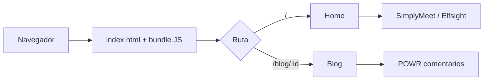

# DOCUMENTACIÓN TÉCNICA — TutiTips

Sitio web de **Tulsi Psicóloga Integrativa** (psicología y arteterapia).
Documento de handoff: arquitectura, convenciones, dependencias, despliegue, Clean Code y buenas prácticas de documentación.

| Campo | Valor |
|---|---|
| Nombre del paquete | `tutitips_web` |
| Repositorio | `tutiitips` |
| Sitio en producción | https://tulsi.calendarhit.com |
| Tipo de aplicación | SPA (Single Page Application) estática |
| Stack | React 18 + Vite 5 + Tailwind CSS 3 |
| Idioma del contenido | Español (Costa Rica) |
| Desarrollado por | Aurigital (https://aurigital.com) |

---

## Tabla de contenidos

1. [Resumen del proyecto](#1-resumen-del-proyecto)
2. [Arquitectura y estructura del proyecto](#2-arquitectura-y-estructura-del-proyecto)
3. [Puesta en marcha local](#3-puesta-en-marcha-local)
4. [Dependencias](#4-dependencias)
5. [Integraciones externas](#5-integraciones-externas)
6. [Convenciones de código](#6-convenciones-de-código)
7. [Guía de Clean Code](#7-guía-de-clean-code)
8. [Checklist de despliegue](#8-checklist-de-despliegue)
9. [Buenas prácticas de Handoff](#9-buenas-prácticas-de-handoff)
10. [Buenas prácticas de documentación técnica en Markdown](#10-buenas-prácticas-de-documentación-técnica-en-markdown)
11. [Deuda técnica conocida y recomendaciones](#11-deuda-técnica-conocida-y-recomendaciones)
12. [Glosario](#12-glosario)

---

## 1. Resumen del proyecto

TutiTips es el sitio web de presentación y captación de pacientes de Tulsi, psicóloga integrativa en Costa Rica. Sus objetivos:

- Presentar a la profesional y sus servicios (terapia individual, de pareja, familiar, talleres privados y arteterapia).
- Promocionar el libro y el contenido de redes (sección TutiTips con feed de Instagram).
- Publicar entradas de blog con comentarios.
- Facilitar el agendamiento de sesiones (widget embebido) y el contacto vía WhatsApp.
- Posicionar en buscadores (SEO básico, Open Graph, Schema.org).

### Rutas

| Ruta | Descripción |
|---|---|
| `/` | Página principal (Home) con todas las secciones |
| `/blog/:id` | Detalle de una entrada del blog (`id` numérico, ver `src/blogData.jsx`) |

### Secciones de la página principal (orden de render)

`Navbar` → `Hero` → `Tulsi` → `Servicios` → `BookSection` → `TutiTipsSection` → `Testimonios` → `Agendar` → `FAQ` → `Contacto`

> La sección `Taller` está comentada en `App.jsx` y `ArteTerapia` existe pero no se renderiza actualmente.

---

## 2. Arquitectura y estructura del proyecto

### Visión general

- **SPA sin backend propio.** Todo el contenido (textos del blog, servicios, FAQ) vive en el código fuente; no hay API ni base de datos.
- **Enrutamiento** del lado del cliente con `react-router-dom` v6.
- **Carga diferida (code splitting)** con `React.lazy` + `Suspense` para las secciones bajo el primer scroll.
- **Estilos** con Tailwind CSS (utilidades) más CSS global mínimo en `index.css` y `App.css`.
- **Animaciones** con AOS (al hacer scroll) y Framer Motion (`SectionWrapper`, Hero, Tulsi).
- **Pantalla de carga** (`LoadingScreen`) que cubre el primer render; el contenido hace fade-in al terminar.

### Estructura de carpetas

```text
tutiitips/
├── index.html                 # Entrada HTML: SEO, Open Graph, Schema.org, fuentes
├── package.json               # Scripts y dependencias
├── vite.config.js             # Vite + plugin React + compresión
├── tailwind.config.js         # Tema: colores, fuentes, gradientes, breakpoints
├── postcss.config.js
├── .eslintrc.cjs              # Reglas de lint
├── public/                    # Archivos servidos tal cual (favicons, og-image, robots, sitemap, fuentes)
│   └── fonts/                 # Fuente Rebellion Knight (.otf/.ttf)
└── src/
    ├── main.jsx               # Punto de entrada React
    ├── App.jsx                # Router, lazy loading, AOS, botón flotante de WhatsApp, Home
    ├── App.css / index.css    # Estilos globales, Swiper, @font-face
    ├── style.js               # Constantes de clases reutilizables (padding, textos)
    ├── blogData.jsx           # Contenido de las entradas del blog (JSX)
    ├── assets/                # Imágenes (.avif), videos (.webm), SVG
    │   └── index.js           # Barril: re-exporta todos los assets
    ├── components/            # Componentes de sección y de página
    │   └── index.js           # Barril de componentes (carga estática)
    ├── constants/index.js     # Datos: navLinks, servicios, etc.
    ├── hoc/
    │   ├── SectionWrapper.jsx # HOC: animación + ancla (id) por sección
    │   └── index.js
    └── utils/motion.js        # Variantes reutilizables de Framer Motion
```

### Componentes principales

| Componente | Responsabilidad |
|---|---|
| `Navbar` / `NavbarBlog` | Navegación principal (home) y del blog |
| `Hero` | Portada con video de fondo y llamada a la acción |
| `Tulsi` | Presentación de la profesional |
| `Servicios` | Carrusel (Swiper) de servicios |
| `BookSection` | Promoción del libro |
| `TutiTipsSection` | Feed de Instagram (Elfsight) |
| `Testimonios` | Carrusel de testimonios |
| `Agendar` | Widget de agendamiento (iframe de SimplyMeet.me) |
| `FAQ` | Preguntas frecuentes (acordeón de Ant Design) |
| `Contacto` | Datos de contacto, mapa, redes |
| `BlogList` / `BlogThumbnail` | Listado y tarjetas del blog |
| `Blog` | Detalle de entrada + comentarios (POWR) |
| `Layout` | Envoltorio de las páginas del blog (navbar + contacto) |
| `LoadingScreen` | Pantalla de carga inicial |

### Flujo de datos

1. `blogData.jsx` exporta `blogPosts` (id, título, resumen, contenido JSX, miniatura, `powrId`).
2. `BlogList` mapea `blogPosts` a `BlogThumbnail`.
3. `Blog` lee `:id` de la URL con `useParams` y busca el post.

### Agregar una nueva entrada de blog

1. Agregar las imágenes `.avif` en `src/assets/blogN/` y exportarlas en `src/assets/index.js`.
2. Añadir un objeto a `blogPosts` en `src/blogData.jsx` con un `id` único y consecutivo.
3. Crear un widget de comentarios en POWR y copiar su ID en `powrId`.
4. Verificar `/blog/<id>` y la miniatura en la lista.

---

## 3. Puesta en marcha local

### Requisitos

- Node.js 18 o superior (recomendado LTS) y npm.
- Git.

### Instalación y ejecución

```bash
git clone <url-del-repositorio>
cd tutiitips
npm install
npm run dev        # servidor de desarrollo con HMR
```

### Scripts disponibles

| Script | Comando | Uso |
|---|---|---|
| `dev` | `vite` | Servidor de desarrollo |
| `build` | `vite build` | Compilación de producción en `dist/` |
| `preview` | `vite preview` | Sirve `dist/` localmente para validar el build |
| `lint` | `eslint . --ext js,jsx --report-unused-disable-directives --max-warnings 0` | Análisis estático (cero warnings permitidos) |

### Variables de entorno

El proyecto **no utiliza variables de entorno**. Los identificadores de terceros (WhatsApp, SimplyMeet, Elfsight, POWR) están en el código. Si se agregan secretos, deben ir en `.env.local` (ya ignorado por `.gitignore` mediante `*.local`) y exponerse con el prefijo `VITE_`.

---

## 4. Dependencias

### Producción (`dependencies`)

| Paquete | Versión | Propósito | Uso en el código |
|---|---|---|---|
| `react`, `react-dom` | ^18.2.0 | Librería de UI | Todo el proyecto |
| `react-router-dom` | ^6.22.0 | Enrutamiento SPA | `App`, `Blog`, `Navbar`, `NavbarBlog`, `BlogThumbnail` |
| `tailwindcss` | ^3.4.1 | Estilos utilitarios | Global |
| `framer-motion` | ^11.0.3 | Animaciones declarativas | `Hero`, `Tulsi`, `SectionWrapper` |
| `aos` | ^2.3.4 | Animaciones al hacer scroll | `App` (`data-aos` en componentes) |
| `swiper` | ^11.2.4 | Carruseles | `Servicios`, `Testimonios` |
| `react-multi-carousel` | ^2.8.4 | Carrusel | `ArteTerapia` |
| `antd` | ^5.14.1 | Componentes UI (acordeón) | `FAQ` |
| `react-icons` | ^5.5.0 | Íconos | `Navbar`, `Hero`, `Contacto` |
| `maath` | ^0.10.7 | Utilidades matemáticas | **Sin uso** |
| `react-parallax-tilt` | ^1.7.209 | Efecto tilt | **Sin uso** |
| `react-select` | ^5.8.0 | Select | **Sin uso** |
| `saas` | ^1.0.0 | — | **Sin uso** (posible error de tipeo de `sass`) |

### Desarrollo (`devDependencies`)

| Paquete | Versión | Propósito |
|---|---|---|
| `vite` | ^5.1.0 | Bundler y servidor de desarrollo |
| `@vitejs/plugin-react` | ^4.2.1 | Soporte React (Babel, Fast Refresh) |
| `vite-plugin-compression` | ^0.5.1 | Genera `.gz` de los assets en el build |
| `postcss`, `autoprefixer` | ^8.4.35 / ^10.4.17 | Procesado de CSS |
| `eslint` | ^8.56.0 | Linter |
| `eslint-plugin-react` | ^7.33.2 | Reglas de React |
| `eslint-plugin-react-hooks` | ^4.6.0 | Reglas de Hooks |
| `eslint-plugin-react-refresh` | ^0.4.5 | Compatibilidad con Fast Refresh |
| `@types/react`, `@types/react-dom` | ^18.x | Tipos para el editor |

### Política de dependencias

- Antes de agregar una librería, verificar que no exista ya una equivalente en el proyecto (hay tres librerías de carruseles/animación).
- Instalar con versiones fijas por `package-lock.json`; **siempre commitear el lockfile**.
- Revisar periódicamente con `npm outdated` y `npm audit`.
- Eliminar dependencias sin uso (ver [sección 11](#11-deuda-técnica-conocida-y-recomendaciones)).

---

## 5. Integraciones externas

| Servicio | Dónde se usa | Qué hace | Qué revisar si falla |
|---|---|---|---|
| **SimplyMeet.me** | `Agendar.jsx` (iframe) | Agendamiento de sesiones: `https://app.simplymeet.me/tuti` | Cuenta activa, URL del widget |
| **Elfsight** | `index.html` (script) + `TutiTipsSection.jsx` | Feed de Instagram | ID de app Elfsight, plan vigente |
| **POWR** | `Blog.jsx` (script dinámico) + `powrId` en `blogData.jsx` | Comentarios del blog | Un `powrId` por entrada |
| **WhatsApp** | `App.jsx` (botón flotante), `Contacto.jsx` | Contacto directo (`wa.me` vía `api.whatsapp.com`) | Número configurado |
| **Google Maps / Waze** | `Contacto.jsx` | Ubicación | URLs de embed |
| **Google Fonts (Sen)** | `index.html` | Tipografía | Carga asíncrona (`media="print"` + `onload`) |
| **Font Awesome 4.7 (CDN)** | `index.html` | Ícono de WhatsApp (`fa-whatsapp`) | Carga asíncrona vía `preload` |
| **Instagram / Facebook** | `Contacto.jsx` | Redes sociales | Enlaces |

> Los números de teléfono, enlaces de redes y los IDs de terceros están repetidos en varios archivos. Ver recomendación de centralizarlos en `src/constants`.

---

## 6. Convenciones de código

### 6.1 Nomenclatura

| Elemento | Convención | Ejemplo |
|---|---|---|
| Componentes React | `PascalCase`, un componente por archivo, archivo `.jsx` con el mismo nombre | `BookSection.jsx` |
| Funciones y variables | `camelCase` | `handleLoadingComplete` |
| Constantes de datos | `camelCase` exportado desde `constants/` | `navLinks` |
| Hooks | prefijo `use` | `useScrollPosition` |
| Carpetas | minúsculas, `kebab-case` si son compuestas | `arte-terapia/` |
| Assets | nombres descriptivos en minúsculas; evitar espacios y tildes | `chicas-abrazo-drama.avif` |
| Commits | ver [6.6](#66-control-de-versiones) | `fix: corrige altura del iframe en móvil` |

### 6.2 Estructura de un componente

```jsx
// 1. Imports: librerías externas → internos → assets → estilos
import React from 'react';
import { SectionWrapper } from '../hoc';
import { logo } from '../assets';

// 2. Componente (función flecha o declaración, con una sola responsabilidad)
const Ejemplo = () => {
  return (
    <section className="relative w-full">
      {/* contenido */}
    </section>
  );
};

// 3. Export por defecto; si es una sección anclable, envolver con SectionWrapper
export default SectionWrapper(Ejemplo, 'ejemplo');
```

Reglas:

- Las secciones de la home se envuelven con `SectionWrapper(Componente, 'id-ancla')`; el `id` debe coincidir con el `id` de `navLinks` en `constants/index.js`.
- Los datos (listas, textos largos) van en `constants/` o `blogData.jsx`, no incrustados en el JSX del componente.
- Los assets se importan **solo** a través del barril `src/assets/index.js`.

### 6.3 Estilos (Tailwind)

- Usar utilidades de Tailwind; evitar CSS propio salvo para librerías de terceros (Swiper, botón WhatsApp) o `@font-face`.
- Usar siempre los **colores del tema** definidos en `tailwind.config.js`, no hexadecimales sueltos:

| Token | Valor | Uso |
|---|---|---|
| `primary` / `verdeclaro` | `#678477` | Verde principal, menú |
| `verdeoscuro` | `#2B5C58` | Textos y fondos oscuros |
| `secondary` | `#F8D0D1` | Rosado de botones |
| `tertiary` | `#FEF9F5` | Fondo claro |
| `customGray` | `#D9D9D9` | Grises de apoyo |

- Fuentes: `font-rebellion` (títulos decorativos, archivo local) y `font-sen` (texto).
- Breakpoints: los estándar de Tailwind más `xs: 450px`. Diseñar **mobile-first** (clase base = móvil; `sm:`, `md:`, `lg:` para ampliar).
- Los fondos con imagen se declaran como `backgroundImage` en `tailwind.config.js` (`bg-agendar`, `bg-book-cover`, etc.).
- Orden sugerido de clases: layout → tamaño → espaciado → tipografía → color → efectos → responsive/estados.

### 6.4 Imágenes y multimedia

- Formato de imagen: **AVIF** (ya estándar en el proyecto). Video: **WebM**.
- Optimizar antes de subir (peso objetivo < 200 KB por imagen de contenido).
- Todo `` lleva `alt` descriptivo en español.
- Imágenes fuera del primer viewport: `loading="lazy"`.

### 6.5 ESLint

Configuración en `.eslintrc.cjs`: `eslint:recommended`, `plugin:react/recommended`, `plugin:react/jsx-runtime` y `plugin:react-hooks/recommended`.

- Ejecutar `npm run lint` antes de cada commit; el script no tolera warnings.
- Prohibido silenciar reglas con `eslint-disable` sin comentario que explique el motivo.
- Pendiente recomendado: agregar Prettier para formato automático (hoy el formato es manual y mixto en comillas y sangría).

### 6.6 Control de versiones

- Rama principal: `main` (protegida; cambios mediante Pull Request).
- Ramas de trabajo: `feature/<descripcion>`, `fix/<descripcion>`, `chore/<descripcion>`.
- Mensajes de commit en formato **Conventional Commits**, en imperativo y concisos:

| Prefijo | Uso |
|---|---|
| `feat:` | Nueva funcionalidad o sección |
| `fix:` | Corrección de un error |
| `style:` | Cambios visuales/formato sin lógica |
| `refactor:` | Reestructuración sin cambiar comportamiento |
| `docs:` | Documentación |
| `chore:` | Dependencias, configuración, build |

- Un commit = un cambio lógico. No commitear `node_modules/`, `dist/` ni archivos `.local`.
- Todo Pull Request incluye descripción de qué cambia, por qué y cómo probarlo, y capturas si hay cambios visuales.

### 6.7 Accesibilidad y SEO

- Un solo `<h1>` por vista; jerarquía de encabezados ordenada.
- Enlaces externos con `target="_blank"` y `rel="noopener noreferrer"`.
- Botones/íconos sin texto deben tener `aria-label`.
- Título y descripción únicos por página (hoy solo están en `index.html`).
- Mantener actualizados `public/sitemap.xml` y `public/robots.txt` al agregar rutas.

---

## 7. Guía de Clean Code

Principios aplicados al contexto de este proyecto React.

### 7.1 Nombres que revelan intención

```jsx
// ❌ Mal
const d = blogPosts.find((p) => p.id === parseInt(i));

// ✅ Bien
const post = blogPosts.find((post) => post.id === Number(id));
```

- Nombres pronunciables y buscables; evitar abreviaturas y números mágicos.
- Booleanos con prefijo `is`, `has`, `should` (`isLoading`).
- Manejadores de eventos con prefijo `handle` (`handleLoadingComplete`).

### 7.2 Funciones y componentes pequeños, con una sola responsabilidad (SRP)

- Un componente que supera ~100 líneas probablemente mezcla responsabilidades: extraer subcomponentes (por ejemplo, tarjeta de servicio, ítem de testimonio).
- Separar **datos**, **lógica** y **presentación**: datos en `constants/`, lógica en hooks personalizados, presentación en el componente.

### 7.3 DRY — No te repitas

- Constantes repetidas (teléfono de WhatsApp, URLs de redes) → una sola fuente en `src/constants`.
- Clases de Tailwind repetidas muchas veces → extraer a un componente o a `style.js`.

```jsx
// constants/contact.js
export const WHATSAPP_NUMBER = '50672801612';
export const whatsappLink = (text = '') =>
  `https://api.whatsapp.com/send?phone=${WHATSAPP_NUMBER}${text ? `&text=${encodeURIComponent(text)}` : ''}`;
```

### 7.4 Comentarios

- El código debe explicarse solo; comentar el **porqué**, no el **qué**.
- **No dejar código comentado** (hay bloques comentados en `App.jsx`, `BlogList.jsx`, `Navbar`): para eso existe Git. Eliminar o abrir un ticket.
- Cada `TODO` lleva responsable o ticket (`// TODO(#12): ...`).

### 7.5 Efectos y limpieza en React

- Todo `useEffect` que cree recursos (scripts, listeners, timers) debe devolver su limpieza, como ya se hace en `Blog.jsx` con el script de POWR.
- Declarar correctamente las dependencias; no desactivar `react-hooks/exhaustive-deps`.
- Evitar estado derivado: si se puede calcular a partir de props/estado, no guardarlo en otro estado.

### 7.6 Manejo de casos límite

```jsx
// ❌ Si el id no existe, post es undefined y la vista se rompe
const post = blogPosts.find((p) => p.id === parseInt(id));
<h1>{post.title}</h1>

// ✅ Manejar el caso no encontrado
if (!post) return <NotFound />;
```

- Validar siempre datos que vienen de la URL o de fuentes externas.
- Usar `key` estables y únicas en listas (id del dato, no el índice).

### 7.7 Rendimiento

- Mantener el `lazy` + `Suspense` en secciones pesadas; no cargar de forma estática lo que está bajo el primer scroll.
- Imágenes AVIF y `loading="lazy"`; videos con `preload` controlado.
- Importar solo lo necesario de librerías grandes (por ejemplo, componentes puntuales de `antd`).

### 7.8 Reglas del Boy Scout y revisión

- Deja el código un poco más limpio de como lo encontraste.
- Checklist de revisión (Pull Request): ¿nombres claros?, ¿sin código muerto?, ¿sin duplicación?, ¿lint sin warnings?, ¿probado en móvil y escritorio?, ¿build exitoso?

---

## 8. Checklist de despliegue

### 8.1 Antes de desplegar

- [ ] Rama de trabajo actualizada con `main` y sin conflictos.
- [ ] `npm install` ejecutado y `package-lock.json` sincronizado.
- [ ] `npm run lint` sin errores ni warnings.
- [ ] `npm run build` finaliza sin errores.
- [ ] `npm run preview` probado: navegación, rutas `/` y `/blog/:id`, recarga directa de una ruta del blog.
- [ ] Probado en Chrome, Safari y Firefox, y en móvil (iOS/Android) y escritorio.
- [ ] Widgets de terceros funcionando: SimplyMeet (agenda), Elfsight (Instagram), POWR (comentarios).
- [ ] Botón de WhatsApp abre el chat con el número y mensaje correctos.
- [ ] Enlaces de redes, mapa y Waze verificados.
- [ ] Textos revisados (ortografía, tildes, datos de contacto actualizados).
- [ ] Imágenes optimizadas (AVIF) y con `alt`.
- [ ] Revisión de rendimiento con Lighthouse (objetivo: Performance, Accessibility, SEO y Best Practices ≥ 90 en producción).

### 8.2 SEO y metadatos

- [ ] `<title>` y `meta description` vigentes en `index.html`.
- [ ] `og:image` (`/og-image.jpg`, 1200×630) existe en `public/` y se ve bien al compartir.
- [ ] `canonical` y `og:url` apuntan al dominio de producción.
- [ ] `public/sitemap.xml` y `public/robots.txt` actualizados (incluir rutas nuevas).
- [ ] JSON-LD (Schema.org) con teléfono y redes correctos.
- [ ] Favicons y `site.webmanifest` presentes (completar `name` y `short_name`).

### 8.3 Proceso de despliegue

El sitio se genera con `npm run build` y se publica el contenido de la carpeta `dist/` en cualquier hosting estático.

1. Fusionar el Pull Request aprobado a `main`.
2. Desde `main` actualizado: `npm ci && npm run build`.
3. Publicar el contenido de `dist/` en el hosting (el build incluye versiones `.gz` de los archivos).
4. **Configurar el fallback de SPA:** toda ruta desconocida (por ejemplo `/blog/1`) debe responder con `index.html`. Sin esto, recargar o compartir un enlace del blog devuelve 404.
5. Verificar que el servidor envíe `Content-Encoding: gzip`/`br` y cabeceras de caché largas para assets con hash (`/assets/*`) y sin caché para `index.html`.
6. Forzar HTTPS y verificar el certificado.

### 8.4 Después de desplegar (smoke test)

- [ ] La home carga completa y sin errores en la consola del navegador.
- [ ] Todas las secciones se muestran (Hero, Tulsi, Servicios, Libro, TutiTips, Testimonios, Agenda, FAQ, Contacto).
- [ ] Un enlace directo a `/blog/1` carga correctamente.
- [ ] El widget de agenda permite elegir fecha y hora.
- [ ] Botón de WhatsApp y enlaces externos funcionan.
- [ ] Vista previa al compartir en WhatsApp/Facebook correcta.
- [ ] Sitemap accesible en `/sitemap.xml`.
- [ ] Etiquetar la versión en Git (`git tag vX.Y.Z`) y anotar los cambios.

### 8.5 Plan de reversión (rollback)

1. Conservar el build anterior (carpeta o artefacto versionado) hasta validar el nuevo.
2. Si falla el smoke test, volver a publicar el build previo o ejecutar `git revert` del commit/merge y reconstruir.
3. Registrar el incidente y la causa en el repositorio.

---

## 9. Buenas prácticas de Handoff

El objetivo del handoff es que la persona que recibe el proyecto pueda **ejecutarlo, modificarlo y desplegarlo sin depender del equipo anterior**.

### 9.1 Checklist de entrega

**Código y repositorio**
- [ ] Rama principal estable, build y lint pasando.
- [ ] Sin ramas ni PRs abiertos sin documentar; ramas obsoletas eliminadas.
- [ ] `README.md` con instrucciones reales del proyecto (reemplazar el texto genérico de la plantilla de Vite).
- [ ] Este documento incluido en el repositorio.

**Accesos y cuentas** (entregar por un gestor de contraseñas, nunca por chat o correo en texto plano)
- [ ] Repositorio (GitHub): permisos de la persona/equipo receptor.
- [ ] Hosting y DNS del dominio `calendarhit.com` (subdominio `tulsi`).
- [ ] SimplyMeet.me (agenda).
- [ ] Elfsight (feed de Instagram).
- [ ] POWR (comentarios del blog).
- [ ] Google Search Console / Analytics (si aplica).
- [ ] Redes sociales vinculadas (Instagram, Facebook).

**Conocimiento**
- [ ] Recorrido (walkthrough) del proyecto: estructura, cómo correrlo, cómo desplegar.
- [ ] Lista de deuda técnica y pendientes priorizados (sección 11).
- [ ] Decisiones de diseño relevantes y su justificación (por qué AVIF, por qué carga diferida, etc.).
- [ ] Contactos: quién decide contenido, quién administra cuentas, soporte.
- [ ] Periodo de acompañamiento definido para resolver dudas posteriores.

### 9.2 Principios

1. **Documentar para quien no estuvo.** Asumir cero contexto: nombres completos, enlaces directos, pasos numerados.
2. **Documentación junto al código.** Vive en el repositorio y se actualiza en el mismo Pull Request que cambia el comportamiento.
3. **Reproducibilidad.** Alguien nuevo debe poder pasar de `git clone` a la app corriendo en menos de 15 minutos.
4. **Decisiones, no solo descripciones.** Registrar el *porqué* (ADR breves) además del *qué*.
5. **Secretos fuera del repositorio.** Credenciales y claves jamás en el código ni en la documentación.
6. **Estado honesto.** Declarar lo que está incompleto, roto o es deuda técnica.
7. **Validar el handoff.** Que el receptor ejecute el proceso completo (clonar, correr, construir, desplegar) mientras el equipo saliente observa y corrige la guía.

### 9.3 Plantilla de registro de decisión (ADR)

```markdown
# ADR-001: <título corto>
- Fecha: AAAA-MM-DD
- Estado: propuesta | aceptada | reemplazada
- Contexto: ¿qué problema o necesidad había?
- Decisión: ¿qué se decidió?
- Consecuencias: ventajas, costos y riesgos.
```

### 9.4 Plantilla de acta de entrega

```markdown
## Acta de handoff — TutiTips
- Fecha:
- Entrega:                  Recibe:
- Versión / commit entregado:
- Accesos transferidos: (lista con fecha)
- Pendientes conocidos: (lista)
- Riesgos: (lista)
- Soporte posterior: (periodo y canal)
- Firmas / confirmación:
```

---

## 10. Buenas prácticas de documentación técnica en Markdown

### 10.1 Estructura y estilo

- Un único `# H1` por documento; jerarquía ordenada (`##`, `###`) sin saltar niveles.
- Incluir tabla de contenidos en documentos largos, con anclas válidas.
- Párrafos cortos, listas para pasos y tablas para comparaciones.
- Voz activa e imperativo en procedimientos ("Ejecuta `npm run build`").
- Un término, un significado: usar el mismo nombre para el mismo concepto en todo el documento.

### 10.2 Bloques de código

- Indicar siempre el lenguaje del bloque (`bash`, `jsx`, `json`) para el resaltado de sintaxis.
- Comandos copiables y completos; separar lo que se escribe de la salida esperada.
- Usar `código en línea` para comandos, archivos, variables y rutas.

### 10.3 Procedimientos

- Pasos numerados, uno por acción, con el resultado esperado.
- Requisitos previos al inicio; solución de problemas al final.
- Usar casillas `- [ ]` para checklists.

### 10.4 Enlaces e imágenes

- Preferir enlaces relativos para archivos del repositorio.
- Texto de enlace descriptivo (no "clic aquí").
- Imágenes con texto alternativo; diagramas como código (Mermaid) cuando sea posible, para versionarlos.

Ejemplo de diagrama versionable:



### 10.5 Mantenimiento

- **Documentación vigente o eliminada:** un documento desactualizado es peor que ninguno.
- Actualizar la documentación en el mismo PR que modifica el comportamiento.
- Indicar fecha de última revisión y responsable.
- Revisar enlaces y comandos de forma periódica (por ejemplo, cada trimestre).
- Ubicación estándar: `README.md` (entrada rápida), `docs/` (guías) y este documento como referencia completa.
- Nunca incluir credenciales, tokens ni datos personales en la documentación.

### 10.6 Estructura recomendada del README

1. Nombre y descripción de una línea.
2. Requisitos.
3. Instalación y ejecución.
4. Scripts.
5. Estructura del proyecto (resumida).
6. Despliegue.
7. Cómo contribuir.
8. Enlace a esta documentación.

---

## 11. Deuda técnica conocida y recomendaciones

Hallazgos de la revisión del código, ordenados por prioridad.

| # | Prioridad | Hallazgo | Recomendación |
|---|---|---|---|
| 1 | Alta | `Blog.jsx` falla si el `id` de la URL no corresponde a una entrada (`post` es `undefined`). | Agregar una vista "no encontrado" o redirección. |
| 2 | Alta | El README es la plantilla genérica de Vite. | Reemplazar siguiendo la sección 10.6. |
| 3 | Media | Dependencias sin uso: `maath`, `react-parallax-tilt`, `react-select`, `saas`. | `npm uninstall maath react-parallax-tilt react-select saas` (verificar `sass` si se necesitara). |
| 4 | Media | Tres librerías de carrusel/animación (Swiper, react-multi-carousel, AOS + Framer Motion) y Ant Design solo para el FAQ: aumentan el peso del bundle. | Unificar en Swiper y evaluar reemplazar el acordeón de `antd` por uno propio. |
| 5 | Media | `index.html` tiene `<html lang="en">` pero el contenido es español; `<body className=...>` debería ser `class`. | Usar `lang="es"` y `class`. |
| 6 | Media | `site.webmanifest` con `name` y `short_name` vacíos; `sitemap.xml` solo con la home. | Completar manifest y agregar las rutas `/blog/:id`. |
| 7 | Media | Teléfono, URLs y IDs de terceros duplicados en varios archivos. | Centralizar en `src/constants` (ver 7.3). |
| 8 | Media | Código comentado y componentes sin uso (`Taller` comentado en `App.jsx`, `ArteTerapia` no renderizado, bloques comentados en `BlogList`). | Eliminar o reactivar; el historial queda en Git. |
| 9 | Baja | `vite.config.js` define `server.historyApiFallback`, que no es una opción de Vite (Vite ya aplica el fallback SPA en desarrollo). | Eliminar la opción. |
| 10 | Baja | `index.css` define `font-family: "Poppins"` global sin cargarla; el tema usa `Sen`. | Alinear la tipografía global con `font-sen`. |
| 11 | Baja | Metadatos SEO únicos solo en `index.html`; las entradas del blog comparten título y descripción. | Metadatos por ruta (por ejemplo `react-helmet-async`) o pre-renderizado. |
| 12 | Baja | Sin pruebas automatizadas ni CI. | Añadir un workflow de CI que ejecute `lint` y `build` en cada PR; evaluar Vitest + Testing Library. |
| 13 | Baja | Los comentarios de POWR y el sitio dependen de scripts de terceros sin plan de contingencia. | Documentar alternativas y manejar fallos de carga. |

---

## 12. Glosario

| Término | Definición |
|---|---|
| **SPA** | Aplicación de una sola página; el navegador carga una vez y el enrutador cambia la vista sin recargar. |
| **HMR** | Hot Module Replacement: actualización en caliente durante el desarrollo. |
| **Lazy loading** | Carga diferida de código o imágenes cuando se necesitan. |
| **HOC** | Higher-Order Component: función que recibe un componente y devuelve otro mejorado (`SectionWrapper`). |
| **Barril (barrel)** | Archivo `index.js` que re-exporta módulos para simplificar imports. |
| **AVIF / WebM** | Formatos modernos y ligeros de imagen y video. |
| **JSON-LD / Schema.org** | Datos estructurados para buscadores. |
| **Open Graph** | Metadatos para la vista previa al compartir enlaces. |
| **ADR** | Architecture Decision Record: registro breve de una decisión técnica. |
| **Conventional Commits** | Convención de mensajes de commit con prefijos (`feat`, `fix`, …). |
| **Smoke test** | Prueba rápida posterior al despliegue para confirmar que lo esencial funciona. |
| **Rollback** | Volver a una versión anterior estable. |

---

*Documento elaborado para el handoff del proyecto TutiTips. Última revisión: 6 de noviembre de 2026.*
